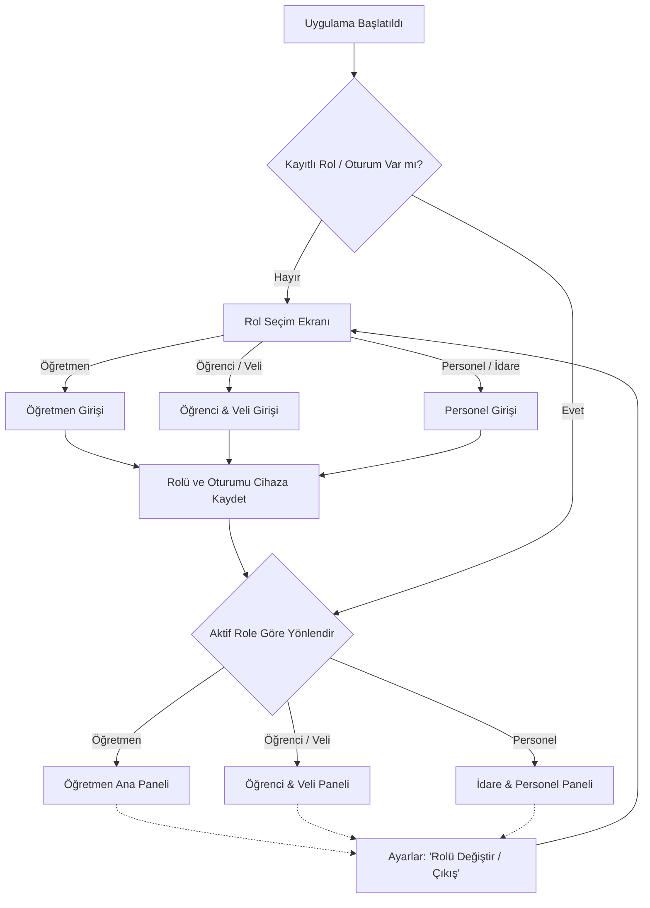
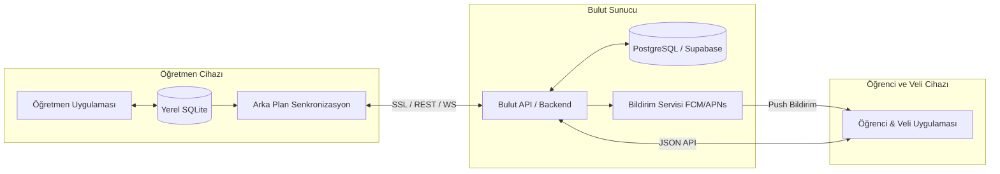

# 📱 Hepsi-Bir-Arada Çok Rollü Eğitim & Ödev Takip Sistemi (Öğretmen - Öğrenci - Personel)
## Mimari, Veritabanı ve Arayüz Tasarım İstişare Raporu

---

### 1. 🎯 Vizyon ve Temel Hedefler

Uygulamanın ticari bir ürüne (SaaS / Kurumsal Okul Platformu) dönüştürülmesi hedeflenmektedir. Bu doğrultuda sistem:
1. **Tek Uygulama (All-in-One)**: Mağazada tek bir uygulama olacak (Android & iOS). Kullanıcı ilk açılışta kendi rolünü seçecek.
2. **Kalıcı Oturum (Auto-Login)**: Seçilen rol yerel hafızada (`AsyncStorage` / `SecureStore`) saklanacak; uygulama menüsünden "Rolü Değiştir / Çıkış Yap" denmediği sürece her zaman ilgili rolün paneline doğrudan girecek.
3. **Roller**:
   - **👨‍🏫 Öğretmen**: Mevcut zengin ödev takibi, yoklama, ders programı, yıllık plan, sınav notları ve yapay zekâ asistanı + *Veli/Öğrenciye bildirim gönderme*.
   - **🎓 Öğrenci & Veli**: Kendisine verilen ödevleri, teslim tarihlerini, ödev durumunu (yapıldı/eksik/yapılmadı), sınav notlarını ve öğretmen notlarını anlık takip eden sade, modern panel.
   - **🏢 Personel / İdare**: Sınıflar, derslikler, genel okul duyuruları, nöbet ve etkinlik ajandası.
4. **Çoklu Platform (iOS & Android)**: App Store ve Google Play yönergelerine tam uyumlu, offline-first hibrit veri yapısı.

---

### 2. 👥 Kullanıcı Rolleri & Akış Mimarisi

#### A. Giriş & Kimlik Doğrulama Yöntemleri
1. **Öğrenci & Veli Girişi**:
   - *Seçenek 1 (En Pratik)*: **Okul Kodu** + **Öğrenci No** + **Veli/Öğrenci Telefonu** (Doğrulama SMS'i veya Öğretmenin belirlediği 4 haneli PIN kodu).
   - *Seçenek 2*: Doğrudan Veli Telefon Numarası ile tek seferlik SMS Kodu (OTP). Bir velinin birden fazla öğrencisi varsa ekranda çocuk seçimi yapılır.
2. **Öğretmen Girişi**:
   - E-posta + Şifre (veya Google ile Giriş / Apple ile Giriş).
3. **Personel & İdare Girişi**:
   - Kurum Kodu + Yönetici E-posta / Şifre.

---

### 3. 🎨 Rol Bazlı Arayüz (UI/UX) Tasarımı

#### 1) 🎓 Öğrenci & Veli Paneli Tasarımı
Öğrenci ve veliler karmaşık yönetim ekranlarına ihtiyaç duymazlar. Onlar için **net, motive edici ve okunabilir** kart tasarımları gereklidir:

* **Tab 1: Bugün & Ödevlerim (`Home / Assignments`)**
  - Üst Kısım: Öğrenci Profil Özeti (Ad Soyad, Sınıfı, Numara, Profil Fotoğrafı, Günün Tarihi).
  - Motivasyon Rozeti: "Tebrikler! Bu haftaki tüm ödevlerini tamamladın 🎉" veya "Teslim tarihi yaklaşan 2 ödevin var!".
  - Ödev Kartları:
    - Ders Adı (Renkli ders rozeti), Ödev Başlığı, Açıklaması.
    - Teslim Tarihi ve Kalan Gün Sayısı ("Yarın Son Gün" uyarısı).
    - Durum Rozeti: `Bekliyor` (Gri/Mavi), `Yapıldı` (Yeşil), `Eksik` (Sarı), `Yapılmadı` (Kırmızı).
    - Veli/Öğrenci *"Tamamladım / Teslim Ettim"* işaretleme butonu (Öğretmenin onayına düşer).
* **Tab 2: Ders Programı (`Schedule`)**
  - Günlük ve haftalık ders programı, ders saatleri, derslikler ve branş öğretmenleri.
* **Tab 3: Notlarım & Başarı Grafiğim (`Grades`)**
  - Sınav 1, Sınav 2, Performans ve Quiz notlarının listesi.
  - Ödev yapma başarı yüzdesi grafiği (Örn: %92 Başarı).
* **Tab 4: Bildirimler & Öğretmen Notları (`Notifications`)**
  - Öğretmenin öğrenci hakkında girdiği kişisel notlar ("Bugün derse çok aktifti").
  - Okul ve sınıf duyuruları.
* **Tab 5: Profil & Ayarlar**
  - Veli ve öğrenci iletişim bilgilerini güncelleme talebi.
  - Rol değiştirme / Çıkış butonu.

---

#### 2) 👨‍🏫 Öğretmen Paneli Geliştirmeleri (Mevcut Sisteme Eklenecekler)
Öğretmen paneli mevcut güç ve fonksiyonelliğini korurken iki kritik yeni araç kazanacaktır:

1. **"Veliye / Öğrenciye Bildir" Butonu**:
   - Ödev oluşturulduğunda opsiyonel kutucuk: `[x] Sınıftaki velilere anlık bildirim gönder`.
   - Ödev kontrolü yapıldığında: `Yapılmadı` veya `Eksik` işaretlenen öğrencilerin velilerine tek dokunuşla "Toplu Durum Bildirimi Gönder" butonu.
2. **Öğrenci Kartında İletişim Butonları**:
   - Öğrenci listesinde tek tıkla **"Öğrenciyi Ara"**, **"Veliye WhatsApp Mesajı At"**, **"Bildirim Yolla"** kısayolları.

---

#### 3) 🏢 Personel & İdare Paneli Tasarımı
* Okul duyuruları yayınlama (tüm öğretmen ve velilere anında ulaşır).
* Sınıf ve ders programı dağıtımları.
* Nöbetçi öğretmen ve okul etkinlik ajandası.

---

### 4. 🗄️ Veri Mimarisi: Yerel SQLite vs. Bulut (Web) Senkronizasyonu

#### Mevcut Durum (Tamamen Cihaz İçi):
* Şu an tüm veriler cihazdaki **SQLite** veritabanında saklanmaktadır.
* Bu yapı öğretmen tek başına iken mükemmel çalışır, çok hızlıdır ve internetsiz çalışabilir.
* **Ancak:** Veli ve öğrencinin kendi telefonlarından bu ödev ve notları görebilmesi için verilerin internet üzerinden buluta (Cloud Database) aktarılması zorunludur.

#### 💡 Önerilen Hibrit Mimari (Offline-First Sync Engine):

#### Önerilen Bulut Altyapısı: **Supabase (PostgreSQL + Auth + Realtime + Edge Functions)**
1. **Neden Supabase?**:
   - PostgreSQL tabanlıdır (SQLite tablolarımızla %99 birebir uyumludur).
   - Kullanıcı yönetimi (Auth), Rol Bazlı Güvenlik (Row Level Security - RLS) yerleşik olarak gelir.
   - Gerçek zamanlı dinleme (Realtime WebSockets) sayesinde öğretmen ödevi kaydettiği anda öğrencinin ekranında ödev belirir.
   - Maliyet: Başlangıçta ve orta ölçekte **ücretsiz tier** sunar; ticari büyümede cüzi ve ölçeklenebilirdir.
2. **Çevrimdışı Çalışma Garantisi**:
   - Öğretmen sınıfta internet çekmese bile yoklamasını ve ödevini yerel SQLite'a kaydeder.
   - İnternet bağlantısı sağlandığında arka plan servisi verileri bulut veritabanına aktarır.

---

### 5. 🔔 Bildirim Altyapısı (Push Notifications)

Veli ve öğrencileri haberdar etmek için 3 katmanlı bildirim mimarisi:

1. **Mobil Push Bildirimi (Öncelikli & Ücretsiz)**:
   - **Expo Notifications / Firebase Cloud Messaging (FCM) & Apple Push Notification service (APNs)**.
   - Veli ve öğrenci uygulamayı yüklediğinde cihaza özel bir `Push Token` üretilir ve veritabanında ilgili öğrenci/veli kaydına bağlanır.
   - Öğretmen ödev paylaştığında ya da "Durum Bildir" butonuna bastığında sunucu doğrudan bu cihazlara ücretsiz anlık bildirim düşürür.
2. **WhatsApp / SMS Alternatifi (Gelişmiş)**:
   - Bildirim gitmeyen ya da uygulamayı henüz yüklememiş veliler için:
   - Öğretmen ekranında "WhatsApp ile Gönder" seçeneği tıklandığında telefonun yerleşik WhatsApp uygulaması şablon mesajla açılır (`wa.me/905xxxxxxxxx?text=...`). Ekstra maliyet gerektirmez.

---

### 6. 🍏 Apple iOS & Ticari Yayınlama Uyumluluğu

Uygulamanın yakında ticari olarak App Store ve Google Play'de yayınlanabilmesi için yerine getirilmesi gereken kritik teknik ve yasal adımlar:

1. **Apple App Store İnceleme Kılavuzları**:
   - **Hesap Silme (Guideline 5.1.1)**: Uygulama içinde kullanıcının kendi hesabını ve verilerini silebileceği bir buton zorunludur.
   - **Giriş Seçenekleri (Guideline 4.8)**: E-posta ile giriş sunuluyorsa "Apple ile Giriş Yap (Sign in with Apple)" zorunlu tutulabilir. (Öğrenci no/PIN girişi bu kuraldan muaftır).
   - **Abonelik & Ticari Model (In-App Purchase)**: Uygulama öğretmenlere veya okullara ücretli/abonelikli satılacaksa dijital ödemeler Apple StoreKit (IAP) üzerinden yapılmalıdır.
2. **KVKK & Gizlilik**:
   - Öğrenci fotoğrafları, telefon numaraları ve notları kişisel veri (KVKK) kapsamındadır.
   - Açık rıza metni, Gizlilik Politikası (Privacy Policy) URL'si hazırlanmalıdır.
3. **iOS Kullanıcı Arayüzü (UI/UX)**:
   - Dinamik Ada (Dynamic Island), Home Indicator (SafeAreaInsets) ve klavye kaydırma (`KeyboardAvoidingView`) ekranların tamamında sorunsuz çalışmalıdır.

---

### 7. 🚀 Önerilen Yol Haritası ve Fazlar

* **Faz 1 (Tamamlandı ✅)**:
  - Veritabanı yapısına `student_phone`, `parent_name`, `parent_phone` alanları eklendi.
  - `students` tablosu migration'ları hazırlandı ve `ClassDetailScreen` öğrenci ekleme/düzenleme modalına opsiyonel alanlar eklendi.
* **Faz 2 (İstişare & Onay Sonrası)**:
  - Bulut backend tercihi (Supabase vs. Firebase vs. Özel API) kararlaştırılacak.
  - Rol Seçim Ekranı (`RoleSelectScreen`) ve kalıcı oturum yönlendirme altyapısı kurulacak.
* **Faz 3**:
  - Öğrenci ve Veli Paneli arayüzlerinin (`StudentDashboardScreen`, `StudentAssignmentsScreen`) kodlanması.
* **Faz 4**:
  - Push bildirim ve WhatsApp hızlı paylaşım entegrasyonu.
* **Faz 5**:
  - iOS ve Android testleri, ticari abonelik/lisanslama entegrasyonu ve mağaza hazırlığı.
